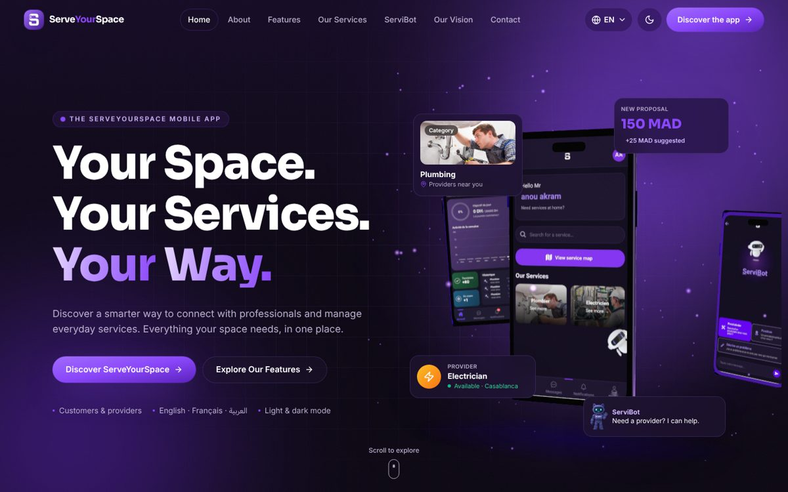
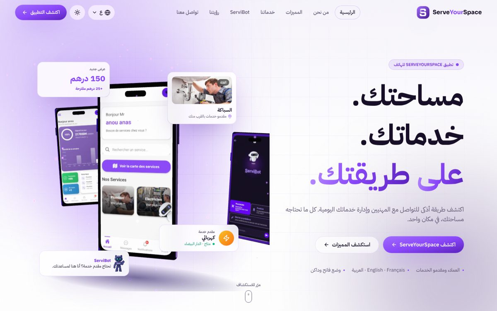
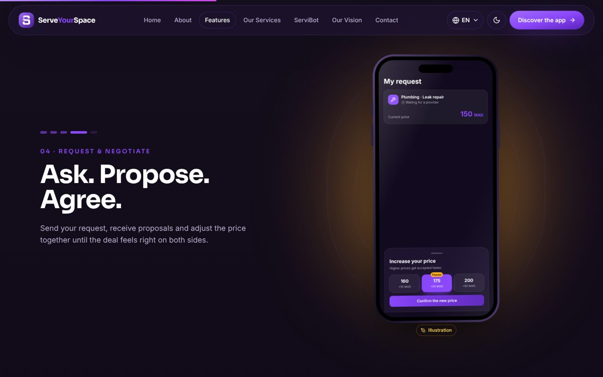
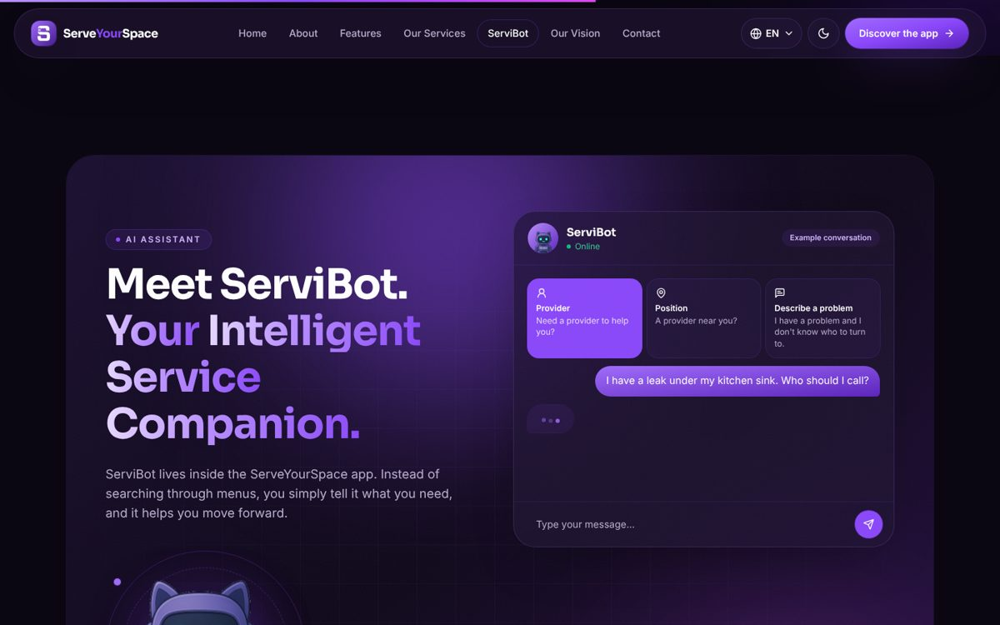
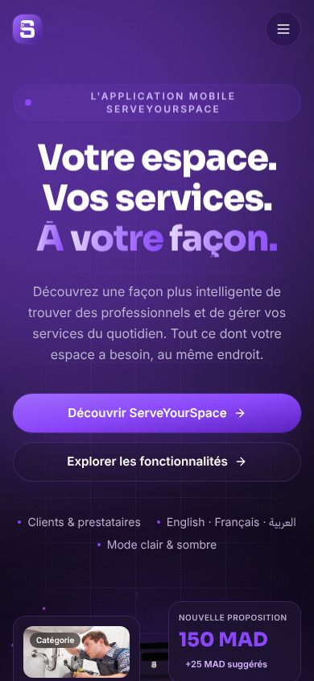

# ServeYourSpace — Showcase Website

Live: https://serve-your-space.vercel.app

Official ServeYourSpace showcase website — a premium, immersive, fully responsive 3D presentation of the ServeYourSpace mobile application and its ecosystem.

ServeYourSpace (SYS) is a mobile services marketplace that connects customers with service providers, with an AI assistant called **ServiBot**. This repository contains only the public website that presents the product. The mobile apps (`Frontend_SYS_Client`, `Frontend_SYS_Prestataire`) and the backend services live in their own repositories and are not modified by this project.



| Arabic (RTL), light mode | Scroll storytelling | ServiBot | Mobile (FR) |
| --- | --- | --- | --- |
|  |  |  |  |

## Features

- **3D hero**: a WebGL smartphone (React Three Fiber) showing real app screenshots, two smaller phones, purple particles, studio lighting, mouse-driven rotation and floating UI cards with parallax. Lazy-loaded, paused when offscreen, with a CSS fallback when WebGL is unavailable.
- **Cinematic scroll storytelling** (GSAP ScrollTrigger): a pinned section where the phone rotates in, then moves through five chapters (the app → discovery → providers → request & negotiation → ServiBot) with screen transitions and lighting changes.
- **App showcase**: a 3D carousel of 11 screens (drag, arrows, keyboard, chips).
- Sections: About (customers / providers, everyday moments), ServiBot (animated conversation), Services (bento grid with 3D tilt), How it works (scroll-drawn timeline), Our vision, Final call to action, Download (App Store / Google Play badges + 3D phone fan), Footer.
- **A page per service** (`/services/plumbing`, `/services/electrical`, ...): description, what providers can help with, steps, a ServiBot example, other services.
- **Three languages**: English (default), Français, العربية, with full right-to-left layout for Arabic. Choice saved in `localStorage`.
- **Dark / light mode**: follows the system preference on first visit, then the visitor's choice (saved). One set of components themed through CSS variables.
- Responsive from 320 px phones to large desktops, touch-friendly controls, reduced-motion support, skip link, keyboard-accessible menus.

### Honest content

- Screens labelled **“App screen”** are real captures of the ServeYourSpace app.
- Screens labelled **“Illustration”** (service categories, request & price negotiation, messaging) redraw features that exist in the app code (`ServicesPage`, `IncreasePriceModal`, chat / messagerie) but for which no clean capture was available yet. Replace them with real captures when available (see below).
- No invented statistics, awards, partners or ratings.

## Tech stack

| Concern | Library |
| --- | --- |
| Build | Vite 5 |
| UI | React 18 |
| Styling | Tailwind CSS 3 + CSS variables (theme tokens in `src/styles/index.css`) |
| 3D | three, @react-three/fiber, @react-three/drei |
| Scroll animation | GSAP 3 + ScrollTrigger |
| UI animation | Framer Motion |
| i18n | i18next + react-i18next |
| Icons | lucide-react |

## Getting started

Requirements: Node.js 18+ (20 or 22 recommended) and npm.

```bash
npm install
npm run dev        # http://localhost:5173
```

### Scripts

| Command | What it does |
| --- | --- |
| `npm run dev` | Development server with hot reload |
| `npm run build` | Production build into `dist/` |
| `npm run preview` | Serves the production build locally (http://localhost:4173) |
| `npm run lint` | ESLint |

## Production build & deployment

```bash
npm run build
```

`dist/` is a fully static site (no server code, no environment variables). Deploy it to any static host:

- **Vercel**: import the repository, framework preset “Vite”, output directory `dist`.
- **Netlify**: build command `npm run build`, publish directory `dist`.
- **GitHub Pages**: build, then publish `dist/` (for a project page served under `/serve-your-space-showcase/`, set `base: '/serve-your-space-showcase/'` in `vite.config.js` and change the absolute asset paths such as `/screenshots/...` accordingly; a custom domain needs no change).
- **Docker / Nginx**: copy `dist/` into `/usr/share/nginx/html` of an `nginx:alpine` image.

## Project structure

```
public/
  screenshots/        real app captures (webp)
  images/services/    service photos from the app assets
  images/servibot/    ServiBot robot (background removed)
  logo/               SYS icon & wordmark from the app assets
  favicon.png, og-image.jpg
src/
  animations/         GSAP registration, Framer Motion variants
  components/         Navbar, LanguageSelector, ThemeToggle, PhoneFrame, Button, ...
    mocks/            illustrative screens (always labelled "Illustration")
  context/
    ThemeContext/     theme state, persistence, system preference
    LanguageContext/  language state, persistence, <html lang/dir>
  data/               screens, services and navigation definitions
  hooks/              useGsap, useMediaQuery, useInView, useActiveSection
  i18n/               i18next setup + list of languages
  layouts/            MainLayout (progress bar, navbar, footer)
  locales/{en,fr,ar}/translation.json
  sections/           Hero, About, Features (scroll story), AppShowcase,
                      ServiBot, Services, HowItWorks, Vision, FinalCTA, Footer
  styles/index.css    Tailwind layers + design tokens
  utils/
  App.jsx, main.jsx
```

## Store links, social links and provider counts

- **App Store / Google Play**: put the store URLs in `src/data/links.js`. While a URL is empty the badge shows a “Soon” ribbon and is not clickable.
- **Social networks**: same file, `SOCIAL_LINKS`. Only icons with a URL are shown in the footer.
- **Number of providers per service**: the site never shows an invented figure. Copy `.env.example` to `.env` and set `VITE_STATS_URL` to a public endpoint returning `{ "Plombier": 12, ... }` (keys = service names in the app catalogue, or the site keys such as `plumbing`). Without it, service pages say “Providers available in the app”.

## Routing and hosting

The site uses client-side routes (`/services/:key`). `npm run build` also writes `dist/404.html`, and the repository contains `public/_redirects` (Netlify) and `vercel.json`, so direct links to service pages work on those hosts.

## Common changes

**Edit a text**: every visible string is in `src/locales/<lang>/translation.json`. Change it in all three files.

**Add a language**: add an entry in `src/i18n/languages.js` (`code`, `label`, `short`, `dir`), create `src/locales/<code>/translation.json` (copy `en`), import it in `src/i18n/index.js`, and allow the code in the small script in `index.html`.

**Replace an illustration with a real screenshot**: put the capture in `public/screenshots/` (webp, ~720 px wide), add it to `SCREEN_IMAGES` in `src/data/screens.js`, and in `SHOWCASE_SCREENS` set `real: true` and remove `mock`.

**Theme colours**: tokens live at the top of `src/styles/index.css` (`:root` for light, `.dark` for dark). The brand scale (`brand-500 = #8a47fa`, `brand-900 = #32106b`) is in `tailwind.config.js`.

## Performance notes

- The three.js scene is a separate lazy chunk; the rest of the page renders before it loads.
- The canvas stops rendering when the hero is offscreen, uses a capped pixel ratio and fewer particles on phones, and renders a single static frame when the visitor prefers reduced motion.
- The pinned scroll story is enabled only on screens ≥ 1024 px without reduced motion; smaller screens get a lighter stacked layout.
- Images are WebP and lazy-loaded below the fold.

## License

© ServeYourSpace. All rights reserved.
